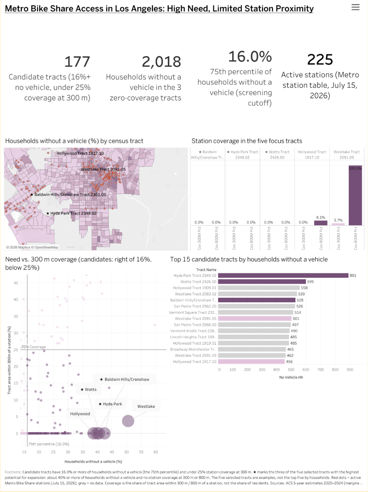

# LA Metro Bike Share Analysis

Where in the City of Los Angeles do households with limited vehicle access also have few Metro Bike Share stations nearby? 

For our **COOP Careers Data Analytics Fellowship** midcycle capstone project, we combined station locations with Census data to identify **177 census tracts for further review** and show where new stations or better connections might improve proximity.

[Tableau dashboard](https://public.tableau.com/views/MidcylceC700Project/Dashboard1) · [Python notebook](metro_stations_eda.ipynb) · [Full Report](report.pdf) · [Presentation](C700_Midcycle_Project_Presentation.pdf)

## Key findings

- **Three tracts had 0% coverage at both 300 m and 800 m.** The highlighted tracts in Hyde Park, Watts, and Baldwin Hills/Crenshaw together had an estimated **2,018 households without a vehicle**.
- **The distance used for the analysis changed the picture.** In Westlake tract 2091.05, only **3.7%** of the area was within 300 m of a station, while **100%** was within 800 m. This tract is a candidate for closer review of station placement and walking routes near the existing network.

| Approximate location | Census tract | Households without a vehicle | Area within 300 m | Area within 800 m |
| --- | --- | ---: | ---: | ---: |
| Hyde Park | 2349.02 | 42.4% | 0% | 0% |
| Watts | 2426.00 | 40.6% | 0% | 0% |
| Baldwin Hills/Crenshaw | 2361.01 | 39.8% | 0% | 0% |
| Westlake | 2091.05 | 50.6% | 3.7% | 100% |

## My contribution

I built the Python notebook in Google Colab. I cleaned the station data, joined Census estimates to tract boundaries, calculated station coverage with GeoPandas and Shapely, and mapped potential gaps with Folium. I also co-authored the report and presented the findings with my COOP Careers C700 team. Stephanie Trujillo-Lemus built the Tableau dashboard.

## How we measured station proximity

1. **Prepared the data.** We kept 225 active station records with usable coordinates from the July 15, 2026 [Metro Bike Share station inventory](https://bikeshare.metro.net/about/data/). We used [2024 Census TIGER/Line boundaries](https://www.census.gov/geographies/mapping-files/time-series/geo/tiger-line-file.html) to select tracts whose centers fell in the City of Los Angeles, then joined [2020–2024 American Community Survey estimates](https://www.census.gov/programs-surveys/acs/data.html) for household vehicle availability, income, and population.
2. **Calculated coverage.** We drew straight-line buffers of 300 m and 800 m around active stations, including stations outside city limits. We merged overlapping buffers and calculated the percentage of each tract's area within each distance.
3. **Screened for potential gaps.** We flagged tracts at or above the 75th percentile for share of households without a vehicle (about 16%) and with less than 25% of their area within 300 m of a station. We ranked the 177 candidates by the estimated number of households without a vehicle and highlighted the top 20.

## Recommendations and limitations

Start by reviewing the three zero-coverage tracts for potential expansion. In Westlake, assess whether an additional station or a better walking connection could improve close access. Before selecting sites, check where residents live, how they can reach stations on foot, and which locations connect safely to transit and cycling routes. Community input and an operational review would help evaluate demand and feasibility.

Coverage measures geographic area within a straight-line distance. Walking routes, road crossings, and the locations of homes can change how residents experience access. The study used exploratory cutoffs to prioritize follow-up.

## Run the notebook

Open the notebook in Google Colab, upload the Metro Bike Share station inventory CSV, and enter your Census API key when prompted. The optional street basemap and HTML map export use a CARTO key.

**Team** · Elizsa Montoya, Stephanie Trujillo-Lemus, Ryan Huynh, Christian Castillo-Nazario, and Warisha Vahidy
